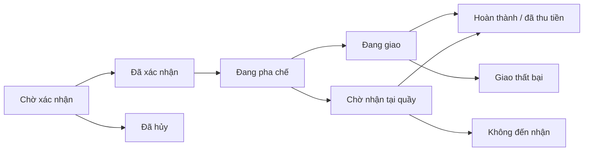

# Tea House — Website đặt trà sữa

Ứng dụng full-stack phục vụ đồ án/CV, gồm cửa hàng trực tuyến và trang quản trị. Có thể chạy ngay bằng chế độ demo SQLite, hoặc cấu hình MySQL 8.0. Dữ liệu lưu ở backend, không lưu đơn hàng trong localStorage.

## Chạy nhanh trên máy của bạn

Mở PowerShell tại thư mục chứa file này:

```powershell
npm.cmd ci --cache .npm-cache
npm.cmd run build
npm.cmd start
```

Trên máy hiện tại, thư viện và bản build đã được chuẩn bị: chỉ cần `npm.cmd start`. Có thể nhấp đúp `CHAY-DU-AN.cmd` để cài thư viện nếu thiếu, build rồi chạy.

Mở **http://127.0.0.1:3000**. Giữ cửa sổ chạy server mở; nhấn Ctrl+C để dừng. Nếu có server đang chạy trên cổng 3000, sử dụng server đó hoặc dừng đúng tiến trình của dự án trước khi chạy lại.

Không có `.env` thì mặc định là chế độ demo. Bản làm việc trên máy hiện đã cấu hình MySQL; dùng mật khẩu website bạn đã nhập khi thiết lập. Gói ZIP không chứa `.env` hoặc dữ liệu riêng. Khi giải nén source ở nơi khác, sao chép `.env.example` thành `.env` nếu cần cấu hình.

### Kiểm tra trước buổi demo

Nhấp đúp **KIEM-TRA-DU-AN.cmd** để chạy kiểm thử, build, kiểm tra bản build bằng database tạm và kiểm tra kết nối database local. Hoặc chạy `npm.cmd run verify`, sau đó `npm.cmd run db:check`. Các kiểm thử mặc định không thay đổi dữ liệu MySQL đang dùng. Khi cổng 3000 đã có server, lần mở thêm sẽ báo lỗi và thoát; nhấn Ctrl+C ở cửa sổ server để đóng kết nối gọn gàng.

Tài liệu kèm theo:

- [Bản thảo báo cáo đồ án](docs/BAO-CAO-DO-AN.md): kiến trúc, dữ liệu, nghiệp vụ và giới hạn; cần điền thông tin sinh viên/trường.
- [Nghiệm thu và demo 5–7 phút](docs/NGHIEM-THU.md): thao tác chạy, checklist và xử lý lỗi.
- [Gợi ý CV và câu hỏi bảo vệ](docs/DEMO-CV.md): nội dung đúng với tính năng đã triển khai.
- [Kết quả kiểm thử](docs/TEST-RESULTS.md): phạm vi đã xác minh.

Đóng gói mã nguồn bằng `python scripts/package-source.py` (cần Python). ZIP nằm cạnh thư mục dự án, có manifest SHA-256; không gồm mật khẩu, database, ảnh tải lên hoặc thư viện đã cài.

### Tài khoản demo

| Vai trò | Email | Mật khẩu |
|---|---|---|
| Quản trị | admin@teahouse.local | Admin@12345 |
| Khách hàng | khach@teahouse.local | Khach@12345 |

Đăng nhập quản trị rồi chọn **Quản trị** trên thanh điều hướng. Tài khoản này chỉ được tự tạo trong database demo mới. Chế độ MySQL dùng mật khẩu seed do bạn thiết lập.

### Phát triển và sửa code

```powershell
npm.cmd run dev
```

Frontend: http://127.0.0.1:5173. Backend: http://127.0.0.1:3000. Vite chuyển tiếp `/api` sang backend. Dừng server `npm start` trước khi chạy dev để tránh trùng cổng 3000. Sửa React/CSS sẽ cập nhật giao diện; backend có Node watch.

```powershell
npm.cmd test
npm.cmd run build
```

Tests mặc định dùng SQLite trong bộ nhớ, không sửa dữ liệu demo của bạn.

## Công nghệ đã khóa phiên bản

- Node.js 24+; đã kiểm tra trên 24.18.0, Windows x64.
- React / React DOM 19.3.0, Vite 8.3.2.
- Express 5.2.1, mysql2 3.24.5, bcryptjs 3.0.3.
- MySQL 8.0 hoặc SQLite tích hợp trong Node cho demo.
- CSS thuần có responsive; minh họa SVG nội bộ. Font Google có phông thay thế khi offline.

Dùng `package-lock.json` và `npm ci` để tái lập phiên bản. Không cần Docker, XAMPP, Tailwind hay build tool C++.

## Chuyển sang MySQL 8.0

### Cách nhanh: nhập trực tiếp trên máy

Nhấp đúp **CAU-HINH-MYSQL.cmd**, hoặc chạy:

```powershell
npm.cmd run db:setup
```

Nhập Host, Port, tên database và **User/Password giống kết nối trong MySQL Workbench**. Ví dụ User có thể là `root` nếu đó là tài khoản bạn đang dùng; `tea_house` chỉ là tên gợi ý trong cấu hình mẫu. Mật khẩu được che bằng dấu `*` và không gửi vào chat.

Trình cấu hình sẽ xác minh kết nối, hỏi trước khi tạo database/bảng, yêu cầu mật khẩu mới cho hai tài khoản website khi database còn trống, rồi khởi tạo dữ liệu. File `.env` chỉ được chuyển sang MySQL sau khi khởi tạo thành công. Mật khẩu web không lưu vào `.env`; database chỉ lưu bản băm bcrypt. Cấu hình `.env` cũ được sao lưu trong `data/config-backups`.

Mật khẩu MySQL do trình cấu hình lưu dưới khóa `DB_PASSWORD_BASE64` để không bị hỏng nếu có dấu nháy hoặc `#`. Đây chỉ là dạng biểu diễn, **không phải bảo mật bằng mã hóa**; vẫn giữ `.env` và bản sao lưu riêng trên máy. Nếu muốn chuyển về `DB_PASSWORD` nhập thủ công, xóa dòng `DB_PASSWORD_BASE64` trước; khóa BASE64 được ưu tiên khi có giá trị.

Sau khi thông báo THÀNH CÔNG: dừng server đang chạy bằng Ctrl+C, mở **CHAY-DU-AN.cmd**, rồi kiểm tra:

```powershell
npm.cmd run db:check
```

Lệnh kiểm tra chỉ đọc, không tạo/xóa dữ liệu. Công cụ không đặt lại tài khoản MySQL, không đổi cấu hình dịch vụ, không chuyển các đơn SQLite sang MySQL. Nếu khởi tạo thất bại giữa chừng, `.env` cũ được giữ nguyên; database mới có thể đã có một số bảng nên hãy kiểm tra lỗi trước khi chạy lại.

### Cách thủ công bằng Workbench

1. Mở MySQL Workbench, đăng nhập kết nối MySQL hiện có bằng tài khoản quản trị của bạn.
2. Chạy SQL dưới đây. Thay mật khẩu mẫu bằng mật khẩu riêng trước khi chạy:

```sql
CREATE DATABASE tea_house CHARACTER SET utf8mb4 COLLATE utf8mb4_unicode_ci;
CREATE USER 'tea_house'@'127.0.0.1' IDENTIFIED BY 'THAY_MAT_KHAU_RIENG';
GRANT ALL PRIVILEGES ON tea_house.* TO 'tea_house'@'127.0.0.1';
```

Nếu database hoặc user đã có, dùng lại cấu hình thích hợp; không xóa database đang có để chạy lại SQL này. Nếu MySQL phân giải kết nối thành localhost, tạo/grant user tương ứng với host được máy chủ báo trong lỗi đăng nhập.

3. Sửa `.env` trên máy:

```dotenv
DB_DRIVER=mysql
DB_HOST=127.0.0.1
DB_PORT=3306
DB_NAME=tea_house
DB_USER=tea_house
DB_PASSWORD="mat_khau_database_cua_ban"
PORT=3000
HOST=127.0.0.1
SEED_ADMIN_PASSWORD="mat_khau_quan_tri_it_nhat_10_ky_tu"
SEED_CUSTOMER_PASSWORD="mat_khau_khach_it_nhat_10_ky_tu"
```

4. Tạo bảng và dữ liệu mẫu:

```powershell
npm.cmd run db:seed
npm.cmd run build
npm.cmd start
```

Email tài khoản seed giống bảng trên; mật khẩu lấy từ `.env`. Seed có transaction và không ghi đè dữ liệu khi đã có người dùng. Startup MySQL tạo bảng nếu thiếu nhưng không tự tạo tài khoản. Không đổi mật khẩu tài khoản đã tồn tại bằng cách chạy seed lại.

MySQL CLI trên máy: `C:\Program Files\MySQL\MySQL Server 8.0\bin\mysql.exe`. Không cần thêm PATH nếu dùng Workbench hoặc mysql2.

Chế độ SQLite và MySQL dùng dữ liệu riêng. Đơn demo không tự chuyển sang MySQL. `.env`, `data/` và `node_modules/` đã được loại khỏi Git; không commit mật khẩu.

## Tính năng đã có

### Khách hàng

- Thực đơn 12 đồ uống, 4 danh mục, tìm kiếm và sắp xếp giá.
- Size M/L, đường 0/30/50/70/100%, ba mức đá, năm topping.
- Giỏ hàng lưu trên trình duyệt: thêm, sửa tùy chọn, đổi số lượng, xóa.
- Đăng ký, đăng nhập, đăng xuất bằng cookie session HttpOnly.
- Nhận tại quầy hoặc giao theo hai khu vực mẫu với phí cố định.
- Báo giá server, mã khuyến mãi, đặt hàng tiền mặt.
- Lịch sử, chi tiết và tiến độ đơn; hủy đơn chờ xác nhận, có lý do.
- Mở phiếu thanh toán của đơn mình và in/lưu PDF bằng hộp thoại trình duyệt.

### Quản trị

- Quản lý đồ uống: thêm, sửa, đổi giá, danh mục, màu minh họa, nổi bật, tạm hết, ngừng bán.
- Tải/thay/xóa ảnh đồ uống từ trang quản trị; ảnh được lưu tại máy chủ và dùng ở thực đơn, chọn món và giỏ hàng.
- Thêm/sửa danh mục và topping; thay đổi giá/tình trạng topping.
- Tạo/sửa mã giảm giá, hạn dùng, mức đơn tối thiểu và giới hạn sử dụng.
- Xem, tìm kiếm, lọc và xử lý đơn theo trạng thái hợp lệ.
- Báo cáo theo ngày Việt Nam: doanh thu, đơn hoàn thành, đơn tạo, đơn hủy, đồ uống bán chạy.
- Xuất CSV doanh thu của kỳ đang hiển thị; in phiếu thanh toán cho mọi đơn.
- Cấu hình tên, số điện thoại, địa chỉ nhận tại quầy, giờ mở cửa, thông báo đầu trang và các khu vực/phí giao hàng.

### Ảnh đồ uống và thông tin cửa hàng

**Quản trị → Đồ uống → Ảnh:** chọn JPG, PNG hoặc WebP dưới 10 MB, xem trước rồi bấm **Lưu ảnh**. Trình duyệt chuyển ảnh thành JPEG tối đa 1600 pixel; máy chủ nhận ảnh dưới 2 MB. Ảnh gốc không được lưu. Chọn **Dùng lại hình minh họa** để bỏ ảnh đã tải. Với món mới, lưu món trước rồi chọn Ảnh. Khi chưa có ảnh hoặc ảnh không tải được, ứng dụng dùng hình minh họa SVG.

Ảnh đã tải nằm trong `data/uploads/`, được giữ qua các lần build. Khi chuyển website sang máy khác, sao chép thư mục này cùng database; gói ZIP mã nguồn không chứa ảnh người dùng đã tải.

**Quản trị → Cửa hàng:** điền thông tin thực tế, lưu để cập nhật đầu trang, chân trang, phần nhận tại quầy và phiếu thanh toán. Địa chỉ/số điện thoại/giờ mở cửa mặc định để trống. Danh sách khu vực ban đầu là dữ liệu mẫu; bạn có thể đổi tên, phí hoặc tắt từng khu vực. Nếu tắt tất cả khu vực, khách chỉ chọn nhận tại quầy. Phí và địa chỉ đã lưu trong đơn cũ được giữ nguyên.

### In phiếu thanh toán và xuất doanh thu

Trong **Đơn của tôi** hoặc **Quản trị → Đơn hàng**, chọn **In / Lưu phiếu thanh toán**. Trang mới hiển thị món, tùy chọn, giá đã chốt, giảm giá, phí giao và tình trạng thanh toán. Chọn **In / Lưu PDF**, rồi chọn máy in hoặc “Lưu thành PDF” trong trình duyệt. Khách chỉ mở được phiếu của mình; quản trị viên xem được mọi đơn. Đơn chưa thanh toán được ghi rõ trên phiếu.

Trong **Quản trị → Tổng quan**, chọn ngày và bấm **Xem báo cáo**, sau đó chọn **Xuất doanh thu CSV**. CSV dùng đúng kỳ báo cáo đang hiển thị, chỉ chứa đơn đã hoàn thành và đã thu tiền, có dòng tổng cộng. Ngày/giờ theo Việt Nam; số tiền là số nguyên VNĐ; mã hóa UTF-8 có BOM để đọc tiếng Việt. Nếu Excel không tự chia cột, dùng nhập dữ liệu từ Text/CSV và chọn dấu phẩy.

### Quy tắc nghiệp vụ

- Giá một ly = giá theo size + giá topping; backend tính lại khi tạo đơn.
- Mỗi topping tối đa một phần/ly, tối đa 5 loại. Bản này cho phép mọi topping đang bán với mọi đồ uống.
- Mỗi dòng tối đa 20 ly; một đơn tối đa 30 dòng.
- Giảm giá chỉ áp dụng tiền món, không vượt quá tiền món. Phí giao được cộng sau giảm giá.
- Mã `CHAO10`: giảm 10.000đ, đơn tối thiểu 60.000đ, hết hạn cuối năm 2030.
- Mã giảm giá tính lượt khi đặt đơn thành công; hủy đơn không hoàn lượt.
- Client gửi request key để server chống tạo đơn trùng khi bấm lại/retry. Cùng key nhưng nội dung khác bị từ chối.
- Tạo đơn, chi tiết, lịch sử và ghi lượt mã nằm trong một transaction. MySQL khóa hàng liên quan khi đặt đơn.
- Lưu snapshot tên món, giá, topping, thông tin nhận hàng để lịch sử không đổi theo thực đơn.
- Chuyển hoàn thành nghĩa là quản trị viên xác nhận đã giao và thu tiền mặt.
- Doanh thu = tổng thanh toán của đơn hoàn thành, đã thu tiền, theo ngày hoàn thành; có bao gồm phí giao hàng, không phải lợi nhuận.
- Danh sách đơn hiển thị tối đa 100 đơn gần nhất; báo cáo truy vấn toàn bộ đơn trong khoảng ngày.



## Cấu trúc mã nguồn

```text
src/main.jsx          Điểm khởi động React và xử lý lỗi hiển thị
src/App.jsx           Cửa hàng và điều hướng chính
src/pages/            Đơn hàng, quản trị, báo cáo, cấu hình cửa hàng
src/components/       Giỏ hàng, chọn món, tài khoản, chỉnh sửa, ảnh, UI dùng chung
src/lib/api.js        Gọi API, định dạng tiền/ngày và nhãn trạng thái
src/styles.css        Giao diện responsive
server/app.js         REST API, xác thực, phân quyền, báo cáo
server/service.js     Tính tiền, đặt đơn, chuyển trạng thái
server/documents.js   Phiếu thanh toán, khoảng ngày và xuất CSV
server/db.js          Kết nối, schema, transaction MySQL/SQLite
server/migrations.js  Migration có phiên bản, nâng cấp dữ liệu cũ
server/store-routes.js API cửa hàng, khu vực và ảnh đồ uống
server/seed.js        Dữ liệu mẫu và tài khoản demo
server/index.js       Khởi động API và phục vụ frontend đã build
scripts/dev.mjs       Chạy frontend/backend cùng lúc
scripts/setup-mysql.mjs Cấu hình MySQL bằng trình nhập mật khẩu cục bộ
scripts/check-db.mjs  Kiểm tra kết nối và tình trạng bảng (chỉ đọc)
tests/api.test.js     Kiểm thử nghiệp vụ/API
docs/API.md           Mô tả API
docs/DATABASE.md      ERD và cấu trúc dữ liệu
docs/TEST-RESULTS.md  Kết quả kiểm thử thực tế
```

## Kịch bản demo đồ án (5 phút)

1. Đăng nhập khách; chọn trà sữa trân châu size L, 50% đường, ít đá, topping trân châu đen; số lượng 2.
2. Mở giỏ, nhập số điện thoại, chọn nhận tại quầy và áp dụng `CHAO10`: tổng 88.000đ.
3. Xác nhận; xem chi tiết và trạng thái trong Đơn của tôi.
4. Đăng xuất, đăng nhập quản trị, vào Quản trị → Đơn hàng.
5. Xác nhận → Pha chế → Chờ nhận → Đã thu tiền / Hoàn thành.
6. Mở Tổng quan, chọn khoảng ngày bao gồm hôm nay: doanh thu và món bán chạy cập nhật.
7. Giải thích server kiểm tra giá, session, quyền truy cập, transaction và snapshot đơn.

## Phạm vi bản đầu

Chưa tích hợp thanh toán trực tuyến, bản đồ, email đặt lại mật khẩu, kho nguyên liệu, đánh giá, tích điểm hay giao hàng thật. Khu vực giao ban đầu là dữ liệu mẫu cần thay trước khi dùng thực tế. Món chưa được tải ảnh riêng dùng SVG minh họa. Đơn cập nhật khi người dùng bấm Làm mới; chưa dùng WebSocket.

## Migration và sao lưu dữ liệu

```powershell
npm.cmd run db:backup
npm.cmd run db:migrate
```

`db:backup` ghi snapshot JSON nén gzip trong `data/db-backups`, gồm các bảng ứng dụng nhưng không gồm mật khẩu kết nối MySQL trong `.env`. File có dữ liệu khách và bản băm mật khẩu: giữ riêng như database, không đính kèm source. Ảnh cần sao lưu riêng thư mục `data/uploads`. Snapshot này dành cho phục hồi có kiểm soát bằng script, không phải SQL dump để import trực tiếp trong Workbench.

`db:migrate` áp dụng các phiên bản chưa có trong bảng `schema_migrations`. Startup và seed cũng gọi migration. Phiên bản 001 nhận diện schema cũ; 002 bổ sung thông tin cửa hàng, đường dẫn ảnh và trạng thái khu vực. Chạy lại không thêm trùng cột hoặc ghi đè dữ liệu. MySQL dùng khóa migration cho từng database; các bước thêm cột kiểm tra tồn tại để có thể tiếp tục nếu DDL trước đó bị gián đoạn. Không sửa nội dung migration đã áp dụng; thêm phiên bản mới cho thay đổi tiếp theo.

Đây là bản đồ án chạy local, chưa công bố lên Internet. Nếu triển khai công khai, cần cấu hình HTTPS, `COOKIE_SECURE=true`, `ALLOWED_ORIGINS` đúng tên miền, `HOST` phù hợp máy chủ và tài khoản/database riêng; không dùng tài khoản demo mặc định. Hạn chế thử đăng nhập hiện lưu trong bộ nhớ một tiến trình.

## Khắc phục nhanh

- `EADDRINUSE`: cổng đang có ứng dụng dùng. Kiểm tra server Tea House đang chạy trước khi mở thêm.
- `Access denied for user`: kiểm tra DB_USER/DB_PASSWORD/quyền host trong MySQL; không tự đặt lại root.
- Nếu đã dùng trình cấu hình, mật khẩu nằm ở `DB_PASSWORD_BASE64`; sửa `DB_PASSWORD` riêng lẻ sẽ không ghi đè khóa BASE64 đang có.
- `Unknown database`: tạo database trong Workbench trước khi seed.
- `MODULE_NOT_FOUND`: chạy `npm.cmd ci --cache .npm-cache` ở đúng thư mục.
- `npm.ps1 cannot be loaded`: dùng `npm.cmd` như các lệnh trên.
- Mất kết nối khi cài: cần mạng lần đầu; không cần mạng để mua hàng demo sau khi cài/build, font có fallback.
