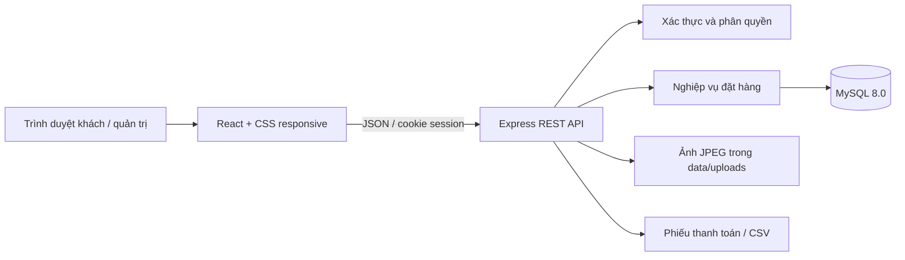
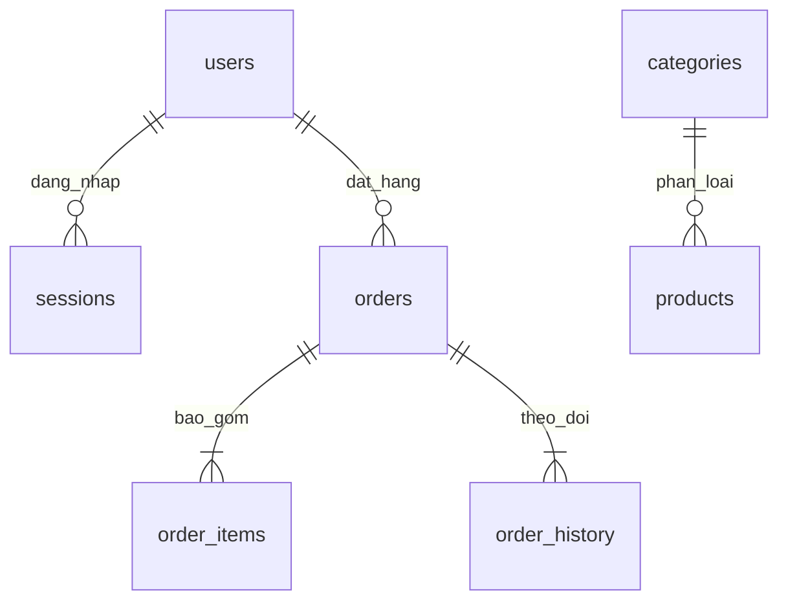
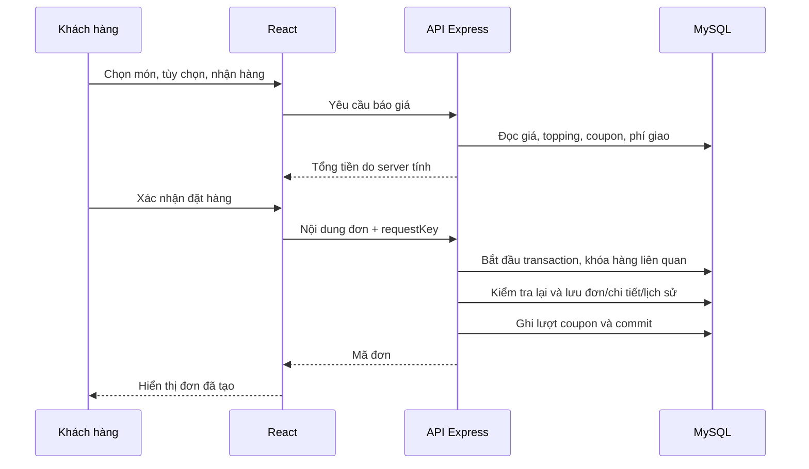

# TEA HOUSE — WEBSITE ĐẶT TRÀ SỮA VÀ QUẢN LÝ CỬA HÀNG

**Bản thảo báo cáo theo mã nguồn hiện tại — cập nhật 02/10/2026.** Điền tên sinh viên, lớp, giảng viên và thông tin trường trước khi nộp. Không đưa tài khoản/mật khẩu MySQL vào báo cáo.

## 1. Giới thiệu đề tài

Cửa hàng trà sữa cần tiếp nhận đơn có nhiều lựa chọn: loại đồ uống, kích cỡ, mức đường, mức đá và topping. Ghi nhận thủ công dễ thiếu thông tin pha chế, tính sai tiền hoặc khó tổng hợp doanh thu. Tea House xây dựng quy trình đặt món trực tuyến, quản lý đơn và theo dõi doanh thu cho một cửa hàng.

Mục tiêu của đồ án là triển khai một ứng dụng full-stack có thể chạy hoàn chỉnh trên máy cá nhân: khách chọn món và đặt hàng, quản trị viên xử lý đơn, hệ thống lưu dữ liệu và tổng hợp báo cáo. Đồ án tập trung vào tính đúng đắn của giá, phân quyền, lịch sử đơn và khả năng tái lập môi trường chạy.

## 2. Phạm vi

Hệ thống có hai vai trò: khách hàng và quản trị viên. Hỗ trợ nhận tại quầy hoặc giao trong các khu vực có phí cố định; thanh toán tiền mặt khi nhận hàng. Website chạy local bằng Node.js và MySQL; có SQLite demo để kiểm thử hoặc chạy khi chưa cấu hình MySQL.

Chưa triển khai thanh toán trực tuyến, bản đồ, tích điểm, đánh giá, quản lý nguyên liệu, email khôi phục mật khẩu hoặc nhiều chi nhánh. Không coi doanh thu là lợi nhuận vì chưa tính giá vốn và chi phí vận hành.

## 3. Phân tích yêu cầu

| Tác nhân | Chức năng |
|---|---|
| Khách chưa đăng nhập | Xem thực đơn, tìm kiếm/lọc/sắp xếp, tùy chỉnh ly, tạo giỏ, đăng ký/đăng nhập |
| Khách đã đăng nhập | Đặt hàng, xem lịch sử/chi tiết đơn của mình, hủy đơn chờ xác nhận, mở phiếu thanh toán |
| Quản trị viên | Quản lý món/danh mục/topping, cập nhật ảnh, cấu hình cửa hàng/vùng giao, quản lý coupon và đơn, xem/xuất báo cáo |

Các yêu cầu phi chức năng chính: giao diện dùng được trên điện thoại; kiểm tra quyền tại API; không tin giá gửi từ trình duyệt; mật khẩu được băm; dữ liệu đơn có thể truy vết; nâng cấp database không làm mất dữ liệu cũ.

### Quy tắc nghiệp vụ

- Đơn giá một ly bằng giá size cộng giá topping. Thành tiền bằng đơn giá nhân số lượng.
- Tùy chọn hợp lệ gồm size M/L, mức đường 0/30/50/70/100 và không đá/ít đá/bình thường.
- Mỗi topping tối đa một phần trên một ly; tối đa 5 loại topping, 20 ly một dòng và 30 dòng một đơn.
- Hai ly khác tùy chọn hoặc ghi chú không tự gộp thành một dòng.
- Coupon kiểm tra thời hạn, giá trị đơn tối thiểu và số lượt. Giảm giá không vượt tiền món; phí giao cộng sau giảm giá.
- Đơn đã đặt giữ lại tên món, đơn giá, topping và thông tin giao nhận tại thời điểm mua.
- Khách chỉ hủy đơn đang chờ xác nhận. Quản trị viên không được nhảy tùy ý qua các trạng thái.
- Doanh thu tính từ đơn hoàn thành và đã thu tiền theo ngày hoàn thành ở múi giờ Việt Nam; bao gồm phí giao hàng.

## 4. Kiến trúc hệ thống

Frontend được tách thành App, pages, components và thư viện gọi API/định dạng. Backend gồm HTTP routes, lớp nghiệp vụ, lớp database/transaction, migration và các hàm xuất tài liệu. Express phục vụ cả REST API và frontend đã build, nên bản local chỉ cần mở một địa chỉ.

Node.js 24 được chọn theo môi trường máy đã kiểm tra. Các phiên bản React, Vite, Express, mysql2 và bcryptjs được khóa trong package-lock.json. Dự án dùng CSS thuần, không sử dụng Tailwind trong bản triển khai hiện tại.

## 5. Thiết kế dữ liệu

Các nhóm bảng gồm tài khoản/session; danh mục/món/topping; vùng giao/cấu hình cửa hàng; coupon; đơn/chi tiết/lịch sử; và phiên bản migration. Xem `DATABASE.md` để biết cấu trúc cụ thể.

`orders` lưu tổng tiền, giảm giá, phí giao, trạng thái và người nhận. `order_items` lưu snapshot của món, size, mức đường/đá, giá và topping. Topping của từng ly lưu dưới dạng JSON snapshot để bảo toàn tên/giá lịch sử. Đây là lựa chọn gọn cho phạm vi đồ án; nếu cần thống kê topping sâu hơn có thể tách bảng liên kết ở phiên bản sau.

Mật khẩu dùng bcrypt; session chỉ lưu hash token, không lưu token cookie gốc. Ảnh sản phẩm lưu ở filesystem; database chỉ chứa đường dẫn do server tạo. Mật khẩu kết nối database nằm trong `.env`, không thuộc mã nguồn công khai.

Migration 001 tiếp nhận schema cơ sở. Migration 002 thêm cấu hình cửa hàng, đường dẫn ảnh và trạng thái hoạt động vùng giao. Mỗi migration có ID trong schema_migrations; các bước thêm cột kiểm tra tồn tại để chạy lại an toàn khi MySQL DDL bị gián đoạn.

## 6. Luồng xử lý đặt hàng

Request key giúp xử lý việc bấm lại hoặc gửi lại cùng yêu cầu mà không tạo nhiều đơn. Nếu cùng key nhưng nội dung khác, API báo xung đột. Nếu giá đã thay đổi so với báo giá trước đó, API yêu cầu khách kiểm tra lại. Việc ghi đơn và coupon nằm trong transaction; lỗi giữa chừng được rollback.

## 7. Xử lý đơn và báo cáo

Đơn đi từ chờ xác nhận sang đã xác nhận, đang pha chế, sau đó đang giao hoặc chờ nhận tại quầy. Hoàn thành chỉ được xác nhận khi đã giao và thu tiền mặt. Hủy/giao thất bại/không đến nhận được lưu riêng kèm lý do.

Báo cáo và CSV dùng chung hàm chọn khoảng ngày và tập đơn doanh thu để tránh lệch số liệu. CSV có BOM UTF-8, dòng tổng và giữ số tiền ở dạng số. Phiếu thanh toán lấy từ snapshot đơn và chỉ được mở bởi chủ đơn hoặc quản trị viên; dữ liệu người dùng được escape khi đưa vào HTML.

## 8. Quản lý ảnh và cửa hàng

Quản trị viên chọn JPG/PNG/WebP. Trình duyệt chuyển ảnh sang JPEG và thu nhỏ trước khi tải; server giới hạn dung lượng, kiểm tra định dạng/kích thước, sinh tên ngẫu nhiên và lưu vào data/uploads. Ảnh không được nhập bằng đường dẫn filesystem hay URL tùy ý.

Tên, điện thoại, địa chỉ, giờ mở cửa và thông báo có thể thay trong trang Cửa hàng. Vùng giao có phí cố định và trạng thái bật/tắt. Vùng đã tắt không nhận đơn mới nhưng thông tin của đơn cũ vẫn được giữ nguyên.

## 9. Kiểm thử và kết quả

Lệnh `npm run verify` chạy test tự động, tạo bản build rồi mở một server/database tạm để kiểm tra frontend và API phối hợp. Không dùng tài khoản hoặc đơn hàng thật cho bộ test này.

Bộ kiểm thử hiện tại có 35 trường hợp, gồm quyền truy cập, giá server, coupon, cạnh tranh request, snapshot, trạng thái, rollback, xuất dữ liệu, cấu hình, ảnh, migration và vòng đời HTTP server. Lần chạy local mới nhất đạt 35/35. Lượt MySQL riêng trước đó đạt 32/32 trước khi bổ sung 3 test vòng đời HTTP không phụ thuộc engine database.

Đã kiểm tra bằng Chrome các luồng đặt hàng, quản trị, phiếu in, CSV, tải ảnh và sửa cửa hàng; có kiểm tra chiều rộng 390px. Chi tiết và giới hạn nằm trong `TEST-RESULTS.md`. Chưa đo tải lớn hoặc kiểm thử Safari, vì vậy không khẳng định hiệu năng ở quy mô sản xuất.

## 10. Kết quả đạt được và hướng phát triển

Đã xây dựng được ứng dụng full-stack chạy local với MySQL, bao phủ quy trình bán trà sữa chính. Có mã nguồn, dữ liệu mẫu, API, migration, kiểm thử và hướng dẫn chạy. Khi demo, nên dùng thông tin cửa hàng và ảnh sản phẩm phù hợp thay cho dữ liệu minh họa.

Hướng phát triển: hoàn thiện bộ ảnh thực tế; tự động hóa E2E đa trình duyệt; phân trang đầy đủ cho lịch sử đơn; bổ sung khôi phục mật khẩu và thanh toán sandbox; triển khai HTTPS và lưu ảnh bền vững khi đưa lên Internet. Chỉ tích hợp dịch vụ ngoài sau khi chốt yêu cầu và môi trường triển khai.
