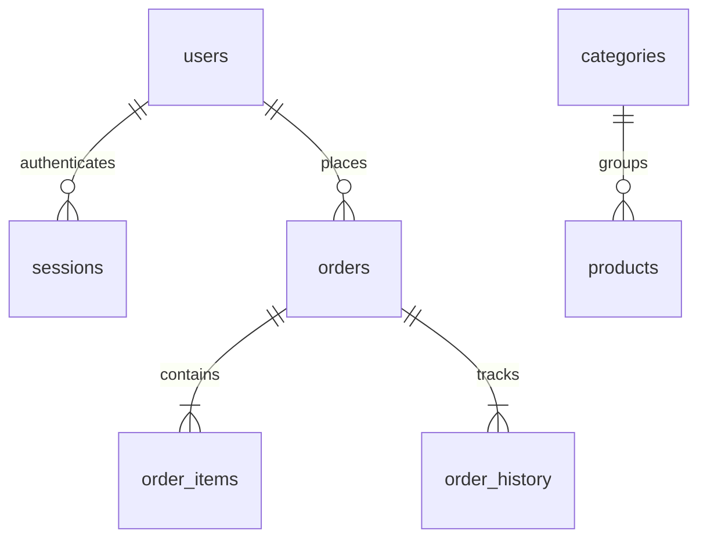

# Cơ sở dữ liệu

Schema thực thi nằm trong `server/db.js`, tự chọn cú pháp khóa tự tăng cho MySQL hoặc SQLite. Tiền lưu integer VNĐ. Timestamp lưu chuỗi ISO UTC để dùng thống nhất hai engine. Driver dùng prepared statements.

| Bảng | Mục đích / khóa |
|---|---|
| users | id; email unique; password_hash; role customer/admin |
| sessions | token_hash primary key; user_id FK; expires_at |
| categories | id; name unique |
| products | id; category_id FK; giá M/L; active/available/featured; màu minh họa |
| store_settings | singleton id=1; tên, địa chỉ, điện thoại, giờ mở cửa, thông báo |
| schema_migrations | id phiên bản duy nhất; applied_at |
| toppings | id; name; price; available |
| delivery_zones | id; name; fee |
| coupons | id; code unique; discount/min_total/expiry/max_uses/used_count/active |
| orders | id; user_id FK; unique(user_id, request_key); request_hash; thông tin nhận; tổng tiền; trạng thái |
| order_items | id; order_id FK; product_id tham chiếu mềm; tên/giá/size/đường/đá/topping snapshot |
| order_history | id; order_id FK; actor_id; status; note; created_at |

`order_items.toppings_json` lưu danh sách `{id,name,price}` tại thời điểm mua. Bản này dùng snapshot JSON thay vì một bảng topping của đơn riêng. `product_id`, `actor_id`, coupon_code và zone_name được lưu để truy vết; các trường snapshot bảo toàn nội dung đơn khi danh mục thay đổi.

MySQL đặt đơn bằng transaction, khóa người dùng để tuần tự hóa request key, khóa sản phẩm/topping/coupon để kiểm tra giá và lượt dùng nhất quán. SQLite demo tuần tự hóa các transaction ghi bằng queue và BEGIN IMMEDIATE. Thao tác quản trị thay đổi dữ liệu cũng đi qua transaction.

Schema được quản lý trong server/migrations.js: 001_baseline giữ schema cũ, 002_store_and_product_images bổ sung products.image_path, delivery_zones.active và bảng store_settings. Bảng schema_migrations đánh dấu phiên bản đã áp dụng. Migration giữ nguyên dữ liệu cũ, kiểm tra cột tồn tại trước khi ALTER và có khóa MySQL để tránh hai tiến trình cùng nâng cấp.

Đơn nhận tại quầy lưu địa chỉ cửa hàng ở thời điểm đặt vào orders.address. Thay đổi địa chỉ sau này không sửa đơn cũ. Khu vực ngừng hoạt động không nhận đơn mới nhưng zone_name/delivery_fee của đơn cũ vẫn được giữ nguyên. Ảnh sản phẩm nằm ngoài database, bảng products chỉ lưu đường dẫn do máy chủ sinh.
